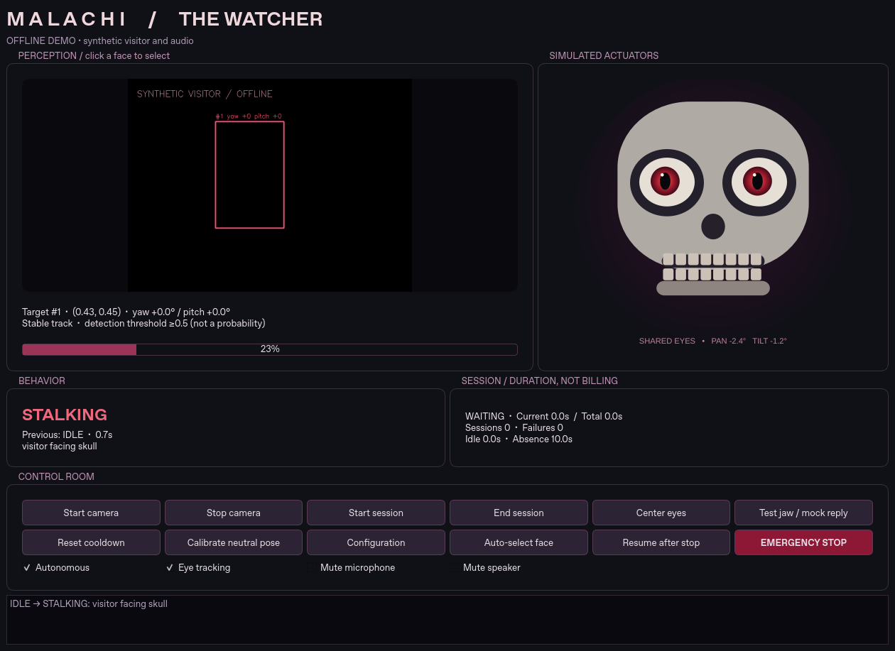

# MALACHI — The Watcher

An autonomous Halloween animatronic skull prototype: local face tracking, shared
animated eyes, a deterministic behavior controller, and optional conversations
with your existing ElevenLabs ghost agent. **No physical hardware is required.**



## Start on a Mac

Use Python **3.11 or 3.12** (the pinned MediaPipe build does not support 3.13).
Install Python from python.org or Homebrew (`brew install python@3.12`). Clone
this repository, open Terminal, and enter its root directory:

```sh
cd AI_Possessed_Skull
python3.12 -m venv .venv
source .venv/bin/activate
python -m pip install -e '.[dev]'
malachi --demo
```

The demo uses a moving synthetic face, periodic look-away/disappearance, and a
**silent synthetic PCM playback simulation**. It exercises shared eyes, blinking,
activation, mock session telemetry, and audio-driven jaw movement without a camera,
microphone, network connection, or account. It does not synthesize intelligible speech.
The Test jaw / mock reply button triggers another synthetic response in a mock session.

For the webcam prototype, install the versioned model once, then launch:

```sh
python scripts/download_model.py
# Optional: copy once, then edit; do not overwrite an existing .env.
cp .env.example .env
malachi --vision-only
```

Model download needs access to `storage.googleapis.com`. It verifies TLS, the
upstream Google Storage checksums (MD5/CRC32C), the task archive CRCs, and a retained local SHA-256.
After installation, vision-only mode works offline. Camera 0 is the default;
change CAMERA_INDEX in `.env` or Configuration, then Stop / Start camera.
Select a face by clicking its box; Auto-select face restores largest-face selection.
Face size is a relative selection heuristic, not measured physical distance.

Face forward at your intended camera position and press **Calibrate neutral pose**.
Yaw/pitch thresholds are relative to that calibration and only approximate attention.
Pose calibration and dashboard configuration changes apply to the current run;
edit `.env` for persistent settings. No facial identities or video are stored.

Run `malachi` with the default mock backend to test autonomous activation against
real webcam input. `--vision-only` disables all conversation activation.

## Connect your existing ghost agent

```sh
python -m pip install -e '.[conversation,dev]'
```

Edit your local, ignored `.env`:

```dotenv
CONVERSATION_BACKEND=elevenlabs
ELEVENLABS_AGENT_ID=your_existing_agent_id
ELEVENLABS_API_KEY=your_key_entered_locally
MOTION_BACKEND=simulation
```

Keep your agent's selected voice and first greeting configured in ElevenLabs.
Configure the conversation's input and output audio as **PCM 16 kHz mono**.
See [ElevenLabs setup](docs/elevenlabs-setup.md) before launching `malachi`.
The application opens one WebSocket per authorized session; idle monitoring does
not stream audio. A prominent indicator shows when remote audio streaming is active.
Use headphones initially to prevent speaker audio from triggering microphone activity.
The prototype uses local RMS activity detection; it does not implement acoustic echo
cancellation. End Session closes the connection; Emergency Stop latches motion and
disables autonomous activation until you explicitly Resume and re-enable it.

## Test

```sh
python -m pip install -e '.[conversation,dev]'
QT_QPA_PLATFORM=offscreen python -m pytest -q
python -m ruff check src tests scripts
python -m ruff format --check src tests scripts
```

Tests use fake timestamps, synthetic images/PCM, mocked WebSockets and Qt's offscreen
platform. No webcam, microphone, API key, ElevenLabs account, or ESP32 is required.
Portable firmware tests compile C with `cc` (Xcode Command Line Tools on Mac);
those tests explicitly skip when no compiler exists. Upstream MIT cJSON is vendored
for these offline tests. The ESP-IDF build is separate.

## Architecture and future hardware

- `src/malachi/vision`: worker capture, Face Landmarker, pose, geometric target selection.
- `behavior`: one deterministic state machine and bounded session policy.
- `conversation`: asyncio WebSocket worker, bounded PCM buffer, PortAudio duplex I/O.
- `motion`: shared-eye filtering, PCM jaw envelope, simulation and optional serial backend.
- `ui`: PySide6 dashboard; all widget updates occur on the Qt thread.
- `firmware/esp32_skull`: mock ESP-IDF UART parser, interpolation, watchdog and stop latch.

See [architecture](docs/architecture.md), [state machine](docs/state-machine.md),
[hardware and Pi plan](docs/hardware.md), [protocol](docs/serial-protocol.md), and
[testing](docs/testing.md). The original requirements are preserved in
[project specification](docs/project-specification.md).

## Current validation and limitations

Cloud Linux validation: offline dashboard startup, mock conversation lifecycle,
pose math on synthetic projected landmarks, timer/motion/audio unit tests,
mocked ElevenLabs protocol, portable C parser and motion interpolation, dependency
integrity, and lint checks. Exact results are in [testing](docs/testing.md).

**Not yet validated:** real Mac camera/microphone/speakers; actual MediaPipe face
inference (the model download is currently blocked by the cloud network policy);
real ElevenLabs authentication, greeting and audio; full ESP-IDF compilation;
Raspberry Pi installation; physical actuators. This is a tested software prototype,
not a claim that every live acceptance criterion has passed.

Camera enumeration is not automatic: select a camera index. Short-lived geometric
tracks are not identities. Cooldown conservatively requires the entire detection
zone to be empty for 5 seconds; a different person entering an occupied zone does
not bypass cooldown. A new geometric target resets qualification. During an active
session, the absence timer follows its original geometric target rather than any face.
Track association can be ambiguous during occlusion or when visitors cross paths.
Head/LED interfaces are prepared but have no physical driver or expressive routines.
Session telemetry is in memory and resets when the application exits.

## Troubleshooting macOS

- Camera/microphone access: System Settings → Privacy & Security → Camera / Microphone.
  Grant access to the Terminal or Python host launching the application, then restart it.
- Black camera preview: close FaceTime/Zoom, change CAMERA_INDEX, and Stop / Start camera.
  Missing model errors include the download command. Temporary camera read failures retry.
- No audio: verify macOS input/output defaults; this adapter requires devices accepting
  16 kHz mono through PortAudio. Device selection/resampling UI is not implemented.
- Install errors: confirm Python 3.11/3.12 and your Mac architecture. Create a fresh venv;
  do not mix system Python, Rosetta, and native arm64 packages.
- Missing PortAudio on Mac: sounddevice wheels normally include it; try `brew install portaudio`.
  On Linux/Pi use your package manager's `libportaudio2` and development packages.
- Feedback: use headphones. Noise gates are not a substitute for echo cancellation.
- Connection failures: check agent ID, local key, PCM format and account limits. Logs omit
  keys, signed URLs and transcript contents. At most 3 pre-connection attempts use backoff;
  established sessions are never automatically replaced after a disconnect.
- Stop latch: wait for the session to close, press Resume after stop, then enable Autonomous.

No `.env`, audio recordings, raw transcripts or camera frames are committed or retained
by default. ElevenLabs service-side retention is configured separately in your account.
