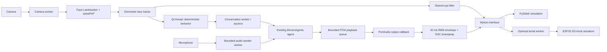

# Architecture

Qt's 20 ms control timer is the sole state-transition and widget owner. Camera capture
and MediaPipe inference run in a separate worker and expose only the latest snapshot,
not an unbounded frame queue. Snapshots older than 500 ms are treated as no visitor.
The camera is unmirrored so normalized camera coordinates and click selection agree.
Face selection retains its current short-lived geometric track; otherwise it chooses
largest apparent face area. Pose uses six 2D/3D landmark correspondences and a generic
face model with a focal-length approximation; neutral calibration is essential.
The landmarker does not supply a per-face probability, so the UI labels the configured
0.5 detection threshold instead of inventing a confidence score.

Network work runs in a worker-owned asyncio loop. A microphone sender worker bridges
PortAudio to the loop; PortAudio callbacks never wait for network traffic. Network
errors are summarized by exception class, excluding URL/token/error bodies.

Agent PCM is buffered independently of inference. Jaw RMS uses blocks actually
consumed by the output callback and is scheduled at `outputBufferDacTime`, including
device buffering. The UI applies due envelopes at 50 Hz. Interruptions clear queued
samples and increment a generation counter so old scheduled jaw updates are discarded.
There may still be a small device-buffer tail already submitted to the OS; hardware
loopback measurements are required to characterize real lip-sync latency.

Motion coordinates are normalized [-1,+1], jaw [0,1]. Only one shared x/y eye mechanism
exists. Physical angle display maps to configured ±20° pan and ±15° tilt placeholders.
The serial worker transmits validated absolute targets and waits for matching ACKs;
transport loss latches STOP. A reconnect never automatically restores physical motion.
Firmware mocks deliberately produce no physical PWM/I2C output.

Workers use bounded queues and explicit shutdown events. Closing the dashboard stops
camera capture, disables autonomous activity, clears playback, ends the WebSocket and
stops hardware output. Native camera calls and signed-URL requests have bounded join/
network timeouts; worker threads are daemonized so unavailable native devices cannot
hold the desktop process open indefinitely.
