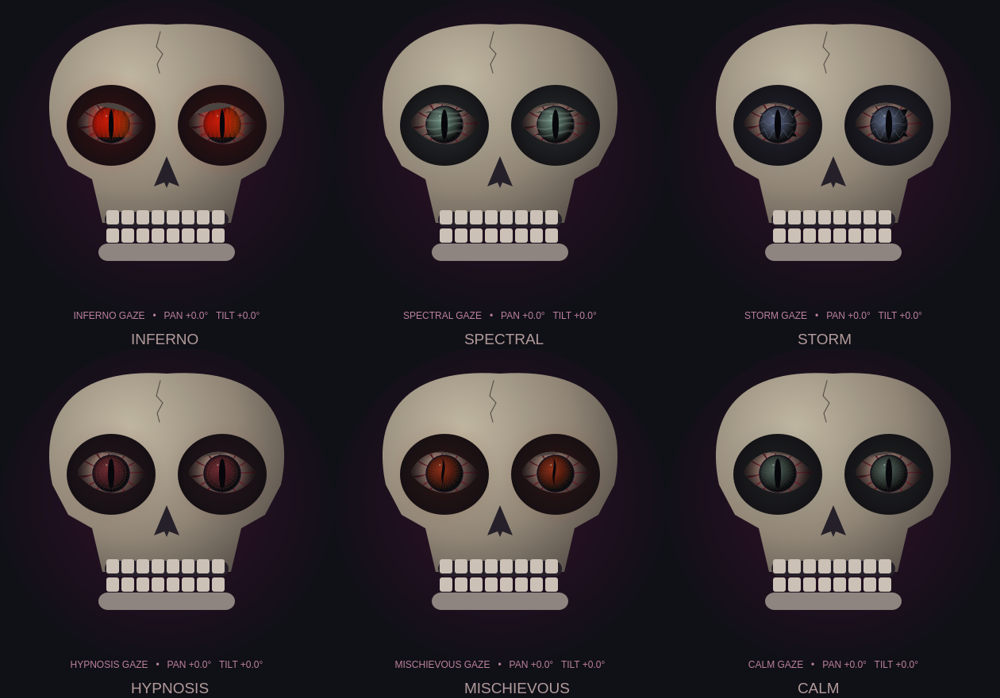

# Agent-controlled possessed eyes

Seven desktop presets are implemented:

| Preset | Visual |
| --- | --- |
| inferno | Deep crimson embers, bloodshot veins, heavy lids and predatory slit pupils |
| spectral | Desaturated spectral eyes with drifting mist, used automatically during speech |
| storm | Cold, dark irises with faint crawling lightning filaments |
| hypnosis | Dark wine-colored concentric rings with slow unsettling distortion |
| mischievous | Sinister rust-colored eyes with crooked slit pupils (legacy tool name) |
| mirror | Live local camera reflection of the selected visitor inside both irises |
| calm | Muted dead-green eyes that settle gently |

The camera reflection is a small, mirrored in-memory crop from the existing selected
face. It is refreshed at most five times per second and released when the effect
ends or no fresh person is visible. The reflection feature does not save or upload
camera images. Existing optional conversation image uploads remain independent.
All animations affect the desktop display only; tracking, jaw motion and hardware
commands remain independent. Palette and intensity changes ease smoothly. Storm
uses moving filaments rather than flashing the screen.

## Configure ElevenLabs once

1. Open the existing MALACHI agent and its **Tools** configuration.
2. Add a **Client tool** named exactly **set_eye_effect** and attach it to the agent.
3. Use the description and parameters from [set_eye_effect.json](tools/set_eye_effect.json).
   `preset` is a required string with the listed enum choices. `intensity` is an optional
   number (0–1, default 0.9); `duration_seconds` is optional (2–20, default 8).
4. Enable **Expects response**, with a three-second response timeout. Save/publish the
   agent configuration and start a new MALACHI session.

Add this guidance to your existing agent system prompt:

```text
You can express your ghost personality using the set_eye_effect client tool.
Choose inferno for theatrical anger; spectral for haunting whispers; storm for
suspense; hypnosis for mystical stories; mischievous for sinister teasing; mirror when
you want the visitor's camera reflection in your eyes; calm to settle. Choose a
style naturally as your performance changes. Use intensity around 0.7–1 and duration
around 6–12 seconds. Keep speaking naturally; don't say tool names or technical
instructions aloud. A successful result means the display request was queued,
not proof of what is visible on a physical skull. Mirror requires a fresh camera
frame. If the tool is unavailable or returns an error, continue the conversation.
```

The cloud workspace cannot configure your remote agent without its credentials;
these steps are performed in your ElevenLabs account. No model override, separate
API key, or parallel-tool toggle is required. Before the tool is configured, automatic
animation varies with conversation state and speech, including occasional mirror
moments in conversation pauses. Agent requests override automatic styles temporarily.
Emergency stop/cooldown clears requests. Invalid presets, values and extra parameters
are rejected; tool changes are limited to one per second. Tool processing does not
block camera rendering or start additional voice sessions.

## Visual preview



Validation: 137 tests passed, with additional targeted eye/dashboard/WebSocket checks
passing after final refinements. The installed ElevenLabs SDK accepts the client-tool
schema. Mocked tool calls produce the documented result packets while audio and ping
continue. Live agent tool selection and real Mac camera reflection require testing
with the configured agent; no remote agent was changed in this cloud environment.

## Dark horror styling

The renderer uses angular, aged bone shading and deep sockets instead of the earlier
rounded cartoon silhouette. Neon palettes, gold star pupils and bright decorative
spirals have been removed. Reflections are dimmed beneath slit pupils, highlights
are small, and the sclera is shadowed and bloodshot. The existing tool preset names
remain compatible; `mischievous` now means a crooked, menacing stare. Effects move
slowly rather than flashing or strobing.
