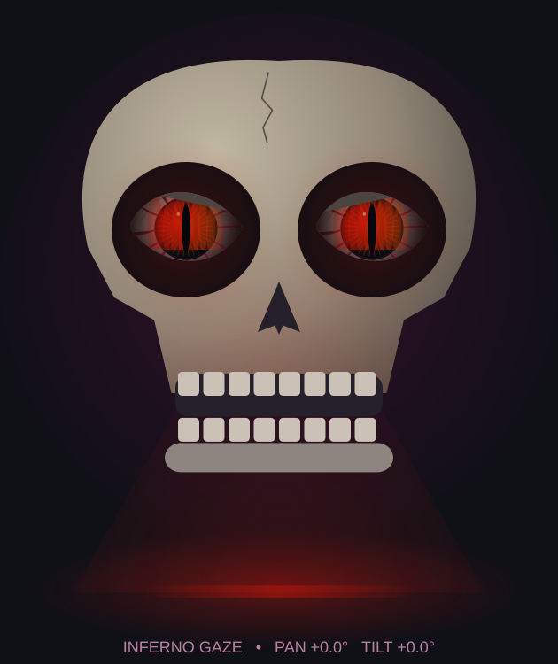

# Under-skull lighting preview

The desktop preview includes a diffused light strip beneath the skull, a soft floor
pool, upward haze and reflected light on the lower face. Color follows the active eye
preset (including agent-selected styles). Brightness eases with eye intensity;
ordinary modes breathe slowly while inferno has a smooth ember pulse. Emergency
stop switches the simulated light off immediately. It restarts gently after resume.



## Future physical LEDs

`UnderLighting` is independent of Qt. Its `LightingFrame` output contains:

- `rgb`: three integer color channels, each 0–255.
- `brightness`: normalized brightness, 0–1.
- `effect`: active preset name, or `off` during emergency stop.

A later LED controller can consume the same state at a suitable update rate and map
it to the selected strip or lamp. Preview intensity is not a calibrated physical
brightness measurement. LED type, wiring, power and protocol are not assumed. This
change sends no new serial commands and does not drive physical LEDs yet.

## Independent agent lighting tool

The `set_underlighting` client tool temporarily overrides eye-linked lighting. Add
it alongside `set_eye_effect` in your ElevenLabs agent's Tools page. The complete
[tool definition](tools/set_underlighting.json) uses these parameters:

| Identifier | Data type | Required | Value type / allowed values |
| --- | --- | --- | --- |
| color | String | Yes | LLM Prompt; red, green, blue, violet, amber, white, cyan, off |
| brightness | Number | No | LLM Prompt; 0–1, default 0.7 |
| effect | String | No | LLM Prompt; steady, breathing, ember; default breathing |
| duration_seconds | Number | No | LLM Prompt; 2–20, default 8 |

Use Wait for response, Immediate execution, disabled pre-tool speech, no tool call
sound, and a three-second response timeout. Leave dynamic variables, assignments
and mocks empty. Save/publish the agent, then start a fresh app conversation.

Add this to the agent system prompt:

```text
Use set_underlighting to choose the light below the skull independently of the eyes.
Choose red for theatrical anger, green/cyan for ghostly secrets, blue/violet for
suspense, amber for ancient stories, white for pale haunting light, or off for darkness.
Choose steady, breathing, or ember movement; use brightness 0.4–0.8 and duration
6–12 seconds normally. Change naturally with the mood. You may use set_eye_effect
and set_underlighting together with different colors. After a lighting override
expires, lighting follows the eyes again. Never announce tools or technical settings;
if a tool fails, continue speaking naturally. These tools control the desktop preview,
not confirmed physical LED operation.
```

Color and brightness transitions ease smoothly. `off` and zero brightness switch off
immediately; emergency stop also clears the override. Session end/cooldown clears
requests. Each tool allows at most one change per second independently, so eye and
light requests can arrive together. Unsupported values are rejected without ending
the voice session. The local app handles the tool, but adding it to your remote agent
must be done in your ElevenLabs account; this cloud change does not modify that agent.
